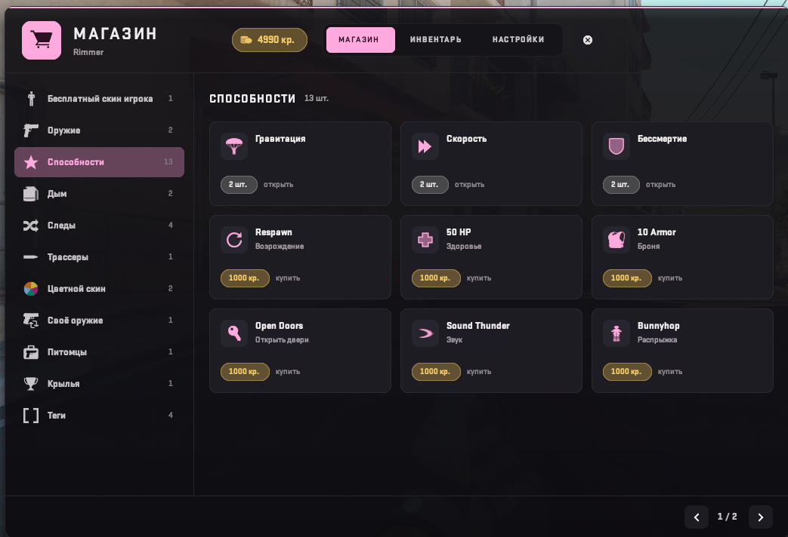

# PMM_StoreCore

<h2><a href="https://genesis-cs.space/menuconstructor/index.html">>>>Более подробная информация на сайте<<<</a></h2>



[English](#english) · [Русский](#русский)

## English

Store panel by **Rimmer** for [cs2-store](https://github.com/schwarper/cs2-store) (schwarper, v33) on top of
[PanoramaMenuManager](https://github.com/RRimmer/PanoramaMenuManagerCS2) (MenuManagerCS2 1.2.04). cs2-store is not changed:
`!store` and `!inv` are intercepted with Harmony and every purchase, equip and sale goes through cs2-store's own `IStoreApi`.

Current version: **0.1.0**. Needs CounterStrikeSharp 1.0.376 (.NET 10), cs2-store v33 and MenuManager 1.2.04.

- Categories on the left, item cards three per row with their state: equipped, owned, price, free or "N short".
  Nested categories are folder cards. No pages: categories, items and the gift player list scroll with the mouse wheel.
- Item page: price, sell price, duration, Buy / Equip / Unequip, Sell and Inspect (player skins, custom weapons).
  It replaces cs2-store's purchase confirmation menu. A bought item is equipped at once (`EquipAfterPurchase`).
- Inventory tab: the same view with owned items only.
- Settings tab: "Hide other players' trails" switch (cs2-store HideTrails) and "Gift credits" (pick a player and an amount, cs2-store Gift). No admin items.
- Panel texts, item types and category names are edited in MenuManager's `MenuManager_Modules_Translation.json` (section `PMM_StoreCore`, per player language).
- Players on another menu type in `!menu` (WASD, CSGO Menu, chat) keep the normal cs2-store menu drawn by PMM.

### Repository layout

| Folder | What it is |
| --- | --- |
| `PMM_StoreCore` | The plugin: `Plugin.cs` (Harmony, commands), `StoreBridge.cs` (cs2-store data by reflection), `Panel.cs` (store panorama), `Translations.cs`, `Config.cs` |
| `PMM_StoreCore/panorama` | Client files for the MultiAddonManager addon: `pmm_store.xml`, `pmm_store.css` |
| `PMM_StoreCore/lib` | `0Harmony.dll` (Lib.Harmony 2.4.2, net10.0), `StoreApi.dll` (cs2-store v33, compile-time only) |
| `tools` | `gen_layout.py` — generates the panorama files (`python3 tools/gen_layout.py PMM_StoreCore`) |
| `MenuManagerApi` | Compile-time library. Do not copy `MenuManagerApi.dll` next to this plugin |
| `configs` | Example config |

### Install from a Release

Copy `Server-plugins/counterstrikesharp` into `game/csgo/addons/`. You get:

- `plugins/PMM_StoreCore/PMM_StoreCore.dll`
- `plugins/PMM_StoreCore/harmony/0Harmony.dll`
- `configs/plugins/PMM_StoreCore/PMM_StoreCore.json`

`0Harmony.dll` stays only in `harmony/`. `StoreApi.dll` and `MenuManagerApi.dll` stay only in `shared/`.
schwarper's CS2MenuManager is not needed: PMM 1.2.04 writes its own `shared/CS2MenuManager`.
Restart the server after an install or update: `css_plugins reload` does not unload Harmony.

Copy `Content-addonmanager/panorama` into the MultiAddonManager addon and rebuild it.

Server console: `css_pmm_store` (status), `css_pmm_store reattach`.

Full guide: [INSTALL.md](INSTALL.md).

### Build

You need the .NET 10 SDK.

```bash
dotnet build PMM_StoreCore.sln --configuration Release
```

Output: `PMM_StoreCore/bin/Release/net10.0/`. Ship `PMM_StoreCore.dll` and `harmony/0Harmony.dll`.
Do not ship `CounterStrikeSharp.API.dll`, `MenuManagerApi.dll` or `StoreApi.dll`.

The changelog is in [CHANGELOG.md](CHANGELOG.md).

### License

[GNU GPL v3](LICENSE).

---

## Русский

Панель магазина от **Rimmer** для [cs2-store](https://github.com/schwarper/cs2-store) (schwarper, v33) поверх
[PanoramaMenuManager](https://github.com/RRimmer/PanoramaMenuManagerCS2) (MenuManagerCS2 1.2.04). cs2-store не меняется:
`!store` и `!inv` перехватываются через Harmony, покупка, надевание и продажа идут через `IStoreApi` самого cs2-store.

Текущая версия: **0.1.0**. Нужен CounterStrikeSharp 1.0.376 (.NET 10), cs2-store v33 и MenuManager 1.2.04.

- Категории слева, карточки предметов по 3 в ряд со статусом: надето, куплено, цена, бесплатно или «не хватает N».
  Вложенные категории — карточки-папки. Страниц нет: категории, предметы и список игроков для подарка прокручиваются колесом мыши.
- Карточка предмета: цена, цена продажи, срок, «Купить» / «Надеть» / «Снять», «Продать» и «Осмотреть» (скины игрока, своё оружие).
  Она заменяет меню подтверждения покупки cs2-store. Купленный предмет сразу надевается (`EquipAfterPurchase`).
- Вкладка «Инвентарь» — то же, только купленное.
- Вкладка «Настройки»: переключатель «Скрывать чужие следы» (HideTrails cs2-store) и «Подарить кредиты» (игрок и сумма, Gift cs2-store). Админских пунктов нет.
- Тексты панели, названия типов и категорий правятся в `MenuManager_Modules_Translation.json` MenuManager (раздел `PMM_StoreCore`, по языку игрока).
- Игроки с другим типом меню в `!menu` (WASD, CSGO Menu, чат) получают обычное меню cs2-store через PMM.

### Что лежит в репозитории

| Папка | Зачем |
| --- | --- |
| `PMM_StoreCore` | Плагин: `Plugin.cs` (Harmony, команды), `StoreBridge.cs` (данные cs2-store через reflection), `Panel.cs` (панорама магазина), `Translations.cs`, `Config.cs` |
| `PMM_StoreCore/panorama` | Клиентские файлы для аддона MultiAddonManager: `pmm_store.xml`, `pmm_store.css` |
| `PMM_StoreCore/lib` | `0Harmony.dll` (Lib.Harmony 2.4.2, net10.0), `StoreApi.dll` (cs2-store v33, только для сборки) |
| `tools` | `gen_layout.py` — генерирует файлы панорамы (`python3 tools/gen_layout.py PMM_StoreCore`) |
| `MenuManagerApi` | Библиотека только для сборки. `MenuManagerApi.dll` рядом с этим плагином не клади |
| `configs` | Пример конфига |

### Установка с Release

`Server-plugins/counterstrikesharp` копируется в `game/csgo/addons/`. Получится:

- `plugins/PMM_StoreCore/PMM_StoreCore.dll`
- `plugins/PMM_StoreCore/harmony/0Harmony.dll`
- `configs/plugins/PMM_StoreCore/PMM_StoreCore.json`

`0Harmony.dll` лежит только в `harmony/`. `StoreApi.dll` и `MenuManagerApi.dll` — только в `shared/`.
CS2MenuManager от schwarper не нужен: PMM 1.2.04 сам кладёт свой `shared/CS2MenuManager`.
После установки или обновления полностью перезапусти сервер: `css_plugins reload` не выгружает Harmony.

`Content-addonmanager/panorama` копируется в аддон MultiAddonManager, аддон пересобирается.

Консоль сервера: `css_pmm_store` (статус), `css_pmm_store reattach`.

Подробная инструкция: [INSTALL.md](INSTALL.md).

### Сборка

Нужен .NET 10 SDK.

```bash
dotnet build PMM_StoreCore.sln --configuration Release
```

Результат: `PMM_StoreCore/bin/Release/net10.0/`. В поставку входят `PMM_StoreCore.dll` и `harmony/0Harmony.dll`.
`CounterStrikeSharp.API.dll`, `MenuManagerApi.dll` и `StoreApi.dll` не клади.

История изменений — в [CHANGELOG.md](CHANGELOG.md).

### Лицензия

[GNU GPL v3](LICENSE).
